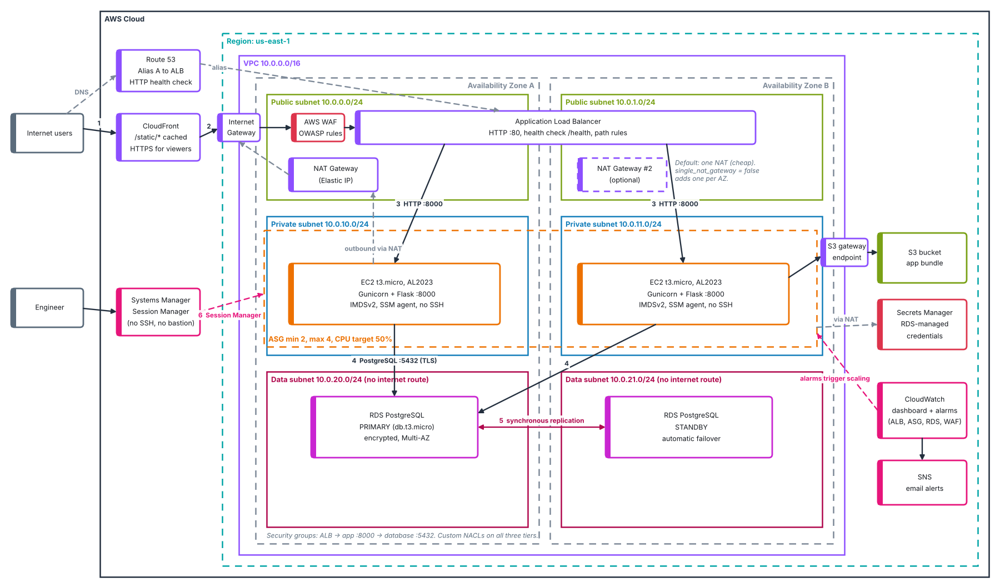

# Ops Board: a scalable, highly available web application on AWS

A production-style, three-tier web application on **EC2 behind an Application Load Balancer**, with **Auto Scaling**, **CloudFront**, **WAF**, a **Multi-AZ RDS PostgreSQL** database, **Route 53**, **Systems Manager Session Manager** and **CloudWatch + SNS** monitoring. Everything is defined as Terraform and deploys with one command.

The workload is a real, small application (an incident and task board with a REST API and a web UI), not a placeholder page. Each response shows which instance and Availability Zone served it, so load balancing, scaling and failover are visible rather than assumed.



*Editable source: [`docs/architecture.drawio`](docs/architecture.drawio) (open in [diagrams.net](https://app.diagrams.net)). Regenerate all formats with `python3 docs/generate_diagram.py`.*

## Contents

1. [How a request flows](#how-a-request-flows)
2. [Requirements coverage](#requirements-coverage)
3. [Repository layout](#repository-layout)
4. [Prerequisites](#prerequisites)
5. [Deploy](#deploy)
6. [Verify and demonstrate](#verify-and-demonstrate)
7. [Cost and the AWS Free Tier](#cost-and-the-aws-free-tier)
8. [Design decisions](#design-decisions)
9. [Security](#security)
10. [Monitoring](#monitoring)
11. [Tear down](#tear-down)
12. [Known limitations and next steps](#known-limitations-and-next-steps)
13. [Verified deployment](#verified-deployment)
14. [References](#references)

## How a request flows

| Step | What happens |
|---|---|
| 1 | A user resolves the site and connects over HTTPS to **CloudFront**. `/static/*` is served from the edge cache. |
| 2 | CloudFront forwards everything else to the **ALB** over HTTP :80 through the Internet Gateway. |
| 3 | **AWS WAF** inspects the request at the ALB (OWASP-oriented managed rules plus a per-IP rate limit). **Listener rules** route by path: `/internal/*` and `/admin/*` get a 403 at the ALB, `/api/*` and the default route go to the target group. |
| 4 | The ALB sends the request to a healthy EC2 instance in a **private subnet** on port 8000 (Gunicorn + Flask). The app reads its database credentials from **Secrets Manager** and queries the **RDS PostgreSQL primary** over TLS. |
| 5 | RDS **Multi-AZ** keeps a synchronous standby in the second AZ and fails over automatically. |
| 6 | Operators reach instances only through **Session Manager**. There are no SSH keys, no open inbound ports and no bastion host. |

Instances in private subnets reach the internet (Systems Manager, Secrets Manager, package mirrors) through the **NAT Gateway**. Downloads of the application bundle from S3 use a free **S3 gateway endpoint** and never touch the NAT Gateway.

## Requirements coverage

| Requirement | Implementation | Where |
|---|---|---|
| VPC with public and private subnets across two AZs | 3 tiers x 2 AZs: public (ALB, NAT), private (EC2), data (RDS, no internet route) | [`network.tf`](terraform/network.tf) |
| NAT Gateway and route tables | NAT in a public subnet, one private route table per AZ, data tier has no default route. `single_nat_gateway` toggles one NAT or one per AZ | [`network.tf`](terraform/network.tf) |
| Security Groups | Chained: ALB, then app :8000, then database :5432. Rules reference groups, not CIDRs | [`security.tf`](terraform/security.tf) |
| NACLs | Custom stateless ACLs on public, private and data tiers, with explicit ephemeral-port return rules | [`network.tf`](terraform/network.tf) |
| EC2 with Launch Template and ASG | AL2023, IMDSv2 only, encrypted gp3, bootstrap from S3 via user data, ELB health checks, rolling instance refresh | [`compute.tf`](terraform/compute.tf), [`user_data.sh.tftpl`](terraform/user_data.sh.tftpl) |
| Target tracking scaling | Average CPU at 50% | [`compute.tf`](terraform/compute.tf) |
| Step scaling | Scale out by 1 or 2 instances depending on how far p90 latency exceeds 5 s | [`compute.tf`](terraform/compute.tf) |
| ALB with Layer 7 routing and health checks | Path-based listener rules (fixed 403 for `/internal/*`, `/admin/*`; forward for `/api/*`), target group health check on `/health` | [`alb.tf`](terraform/alb.tf) |
| WAF rules for the OWASP Top 10 | AWS managed Common, SQLi, Known Bad Inputs and IP Reputation groups, plus a rate-based rule | [`waf.tf`](terraform/waf.tf) |
| CloudFront caching static assets | `/static/*` uses the CachingOptimized policy; dynamic routes bypass the cache | [`cloudfront.tf`](terraform/cloudfront.tf) |
| RDS Multi-AZ MySQL/PostgreSQL | PostgreSQL 16, Multi-AZ, encrypted, managed master secret, data subnets only | [`rds.tf`](terraform/rds.tf) |
| Route 53 alias and health checks | Alias A record to the ALB and an HTTP health check on `/health` (enabled when `domain_name` is set) | [`route53.tf`](terraform/route53.tf) |
| Session Manager instead of a bastion | `AmazonSSMManagedInstanceCore` on the instance role, no SSH key, no inbound rules | [`iam_storage.tf`](terraform/iam_storage.tf) |
| CloudWatch dashboards, alarms and SNS | 8-widget dashboard, 6 alarms (5xx, unhealthy hosts, latency, ASG CPU, RDS CPU, RDS storage), SNS email topic | [`monitoring.tf`](terraform/monitoring.tf) |

## Repository layout

```
.
├── app/                    Flask application (task board + REST API)
│   ├── webapp/             package: routes, models, config, instance metadata, UI
│   ├── tests/              pytest suite (15 tests)
│   └── wsgi.py             Gunicorn entry point
├── terraform/              all infrastructure
│   ├── network.tf          VPC, subnets, NAT, route tables, endpoint, NACLs
│   ├── security.tf         security groups
│   ├── alb.tf  waf.tf  cloudfront.tf  route53.tf
│   ├── compute.tf          launch template, ASG, scaling policies
│   ├── rds.tf  iam_storage.tf  monitoring.tf  outputs.tf
│   └── user_data.sh.tftpl  instance bootstrap
├── scripts/                verify.sh, load_test.sh, failover_test.sh
├── docs/                   architecture diagram (drawio, png, svg) and its generator
└── .github/workflows/      CI: app tests, terraform fmt and validate
```

## Prerequisites

* An AWS account and credentials configured locally (`aws configure` or SSO)
* [Terraform](https://developer.hashicorp.com/terraform/install) 1.9 or newer
* AWS CLI v2 and the [Session Manager plugin](https://docs.aws.amazon.com/systems-manager/latest/userguide/session-manager-working-with-install-plugin.html) (only for the Session Manager demo)
* Python 3.11+ (only to run the app tests or the app locally)

## Deploy

```bash
git clone https://github.com/Fetheddine-Addad/aws-scalable-web-app-project.git
cd aws-scalable-web-app/terraform

cp terraform.tfvars.example terraform.tfvars   # set alarm_email at least
terraform init
terraform fmt -recursive
terraform validate
terraform plan
terraform apply
```

Expect about 15 to 20 minutes: RDS Multi-AZ takes 10 to 15 minutes to create, then the instances boot, install dependencies and register healthy. `terraform apply` waits until the ASG has healthy targets.

```bash
terraform output cloudfront_url   # primary entry point (HTTPS)
terraform output alb_url          # direct ALB (HTTP), used by Route 53
terraform output dashboard_url    # CloudWatch dashboard
```

Run the app locally (SQLite, no AWS needed):

```bash
cd app
pip install -r requirements.txt pytest
pytest -q
LOAD_ENDPOINT_ENABLED=true python -m flask --app wsgi run
```

### Optional: Route 53 alias

Set `domain_name` and `hosted_zone_id` in `terraform.tfvars` (the hosted zone must already exist). Terraform adds an alias A record to the ALB and an HTTP health check.

## Verify and demonstrate

Set the URLs once:

```bash
cd terraform
CF=$(terraform output -raw cloudfront_url)
ALB=$(terraform output -raw alb_url)
```

**1. Load balancing across both AZs**

```bash
../scripts/verify.sh "$ALB" 20
```

Requests are spread across instances in both Availability Zones (the `X-Served-By` and `X-Availability-Zone` response headers), the app endpoints return 200, and the WAF and ALB rule checks return 403.

**2. CloudFront caching**

```bash
curl -sI "$CF/static/css/style.css" | grep -i -E 'x-cache|age'   # first: Miss, repeat: Hit from cloudfront
curl -sI "$CF/api/tasks"            | grep -i x-cache             # dynamic: Miss from cloudfront every time
```

**3. WAF (OWASP protections)**

```bash
curl -s -o /dev/null -w '%{http_code}\n' -G "$ALB/" --data-urlencode 'q=<script>alert(1)</script>'   # 403, XSS
curl -s -o /dev/null -w '%{http_code}\n' -G "$ALB/api/tasks" --data-urlencode "status=' OR '1'='1"   # 403, SQLi
curl -s -o /dev/null -w '%{http_code}\n' "$ALB/internal/x"                                            # 403, ALB listener rule
```

Blocked requests appear in the WAF section of the dashboard.

**4. Auto Scaling**

```bash
../scripts/load_test.sh "$ALB"          # about 7 minutes of CPU load, run it from one machine
aws autoscaling describe-scaling-activities \
  --auto-scaling-group-name "$(terraform output -raw asg_name)" --max-items 5
```

Within roughly 3 to 5 minutes, average CPU passes 50%, the target tracking policy adds instances (up to 4) and the dashboard shows the fleet growing. Scale-in happens about 15 minutes after the load stops.

> Burstable instances: with the default `cpu_credits = "standard"`, a t3.micro throttles after its launch credits run out (about 6 minutes at full load). That is enough to demonstrate scale-out. Set `cpu_credits = "unlimited"` for a longer run.

**5. Instance failure**

```bash
ID=$(aws ec2 describe-instances --filters "Name=tag:Name,Values=opsboard-demo-web" "Name=instance-state-name,Values=running" \
     --query 'Reservations[0].Instances[0].InstanceId' --output text)
aws ec2 terminate-instances --instance-ids "$ID"
```

The site keeps answering from the other AZ while the ASG launches a replacement.

**6. Database failover**

```bash
../scripts/failover_test.sh "$(terraform output -raw rds_identifier)" "$ALB"
```

`/health` stays 200 throughout. `/health/ready` reports 503 for roughly 60 to 120 seconds while the standby is promoted, then recovers. Confirm with `aws rds describe-events --source-type db-instance --duration 30`.

**7. Session Manager (no SSH, no bastion)**

```bash
aws ssm start-session --target "$ID"
sudo systemctl status opsboard
sudo journalctl -u opsboard -n 20
```

The app security group has no inbound rule other than the ALB, and no key pair is attached to the instances.

**8. Alarms**

Confirm the SNS subscription email, then stop the app on one instance (`sudo systemctl stop opsboard` through Session Manager). The unhealthy-hosts alarm fires and sends an email, and the ASG replaces the instance.

## Cost and the AWS Free Tier

This project is meant to be deployed, tested and destroyed in a single sitting. **Not everything in it is free**, so do not leave it running.

| Component | us-east-1 list price | Notes |
|---|---|---|
| NAT Gateway | $0.045 per hour + $0.045 per GB | Not covered by the old free tier at all |
| Application Load Balancer | about $16.43 per month ($0.0225 per hour) + LCUs | LCU charges are small at demo traffic |
| Public IPv4 addresses | $0.005 per hour each | 1 NAT + 2 ALB nodes |
| AWS WAF | $5 per web ACL + $1 per rule or rule group per month + $0.60 per million requests | 5 rules here |
| RDS PostgreSQL db.t3.micro Multi-AZ | roughly double a Single-AZ instance | Check the pricing calculator for the exact rate |
| EC2 t3.micro x 2 | about $0.0104 per hour each | Free tier eligible |
| CloudFront, SNS, CloudWatch dashboard, S3 | within free usage at this scale | CloudFront includes 1 TB per month free |

* A three-hour test session costs well under $1 at list prices.
* Left running, the stack costs roughly **$110 per month**, dominated by NAT, RDS Multi-AZ, ALB and IPv4 addresses.
* Accounts created on or after 15 July 2025 use the credit-based Free Tier: $100 in credits at sign-up plus up to $100 more for completing activities, valid for up to 12 months. On the **Free plan** the account is protected from card charges and closes when credits run out or after six months. On the **Paid plan**, usage beyond credits is billed.
* AWS's list of services available on the Free plan includes ALB (Elastic Load Balancing), WAF, RDS, CloudFront, Route 53, Secrets Manager, Systems Manager, CloudWatch and SNS. **NAT Gateway is not named in that list.** If `terraform apply` fails on the NAT Gateway with an access or plan error, that is the cause. See the [Free Tier documentation](https://docs.aws.amazon.com/awsaccountbilling/latest/aboutv2/free-tier.html) for the account options.
* To lower the bill further for a test: keep `single_nat_gateway = true` (default) and `db_multi_az = false` only if you do not need to demonstrate failover. Multi-AZ is the point of the project, so the default keeps it on.

Set a [AWS Budgets](https://console.aws.amazon.com/billing/home#/budgets) alert before you start.

## Design decisions

| Decision | Reason and trade-off |
|---|---|
| Shallow ALB health check (`/health`) and a separate deep check (`/health/ready`) | During an RDS failover a database-aware check would mark every instance unhealthy and the ALB would have nothing to route to. A shallow check keeps the fleet in rotation and lets the app return a clear 503 for database calls. |
| One NAT Gateway by default | Cuts the hourly cost in half. The trade-off is that an AZ-A outage removes outbound internet for AZ-B. Production should set `single_nat_gateway = false`. |
| S3 gateway endpoint | Free, and keeps bundle downloads off the NAT Gateway's per-GB charge. |
| RDS-managed master password | The password is generated by RDS and stored in Secrets Manager. It never appears in Terraform code or state, and the app fetches it at start-up. |
| IMDSv2 only, no SSH, SSM for access | Removes the SSRF-to-credentials path and the need to open or manage port 22. |
| Target tracking for steady state, step scaling for latency spikes | Target tracking handles scale-in and the normal case. The step policy reacts harder when users already feel slowness. They watch different metrics, so they do not fight each other. |
| Application bundle delivered through S3 and user data | Keeps instances reproducible without baking an AMI. New code changes the launch template and triggers a rolling instance refresh. A production pipeline would bake or build artifacts in CI. |
| Terraform only | One tool, one state, a clean `destroy`. |

## Security

* **Network:** three tiers, security groups chained by reference, custom NACLs, data tier with no route to the internet
* **Edge:** HTTPS at CloudFront, WAF managed rules and rate limiting at the ALB, optional `restrict_alb_to_cloudfront` to accept only CloudFront origin-facing IPs
* **Compute:** IMDSv2 required, encrypted volumes, no SSH, least-privilege instance role (read the app bundle, read one secret)
* **Data:** encryption at rest, TLS to the database, credentials in Secrets Manager
* **Input handling in the app:** validated JSON payloads, parameterised queries through SQLAlchemy, UI rendered with `textContent` (no HTML injection)

## Monitoring

The `<project>-<env>-overview` CloudWatch dashboard shows request volume and 5xx, p50 and p90 latency, instances in service, fleet CPU against the scaling target, healthy and unhealthy hosts, RDS CPU and connections, WAF allowed and blocked requests, and CloudFront requests and cache hit rate. Alarms notify the SNS topic (email).

## Tear down

```bash
cd terraform
terraform destroy
```

Destroy takes about 10 to 15 minutes (CloudFront and RDS are the slow parts). Afterwards, confirm in the console that nothing is left: **EC2** (instances, volumes, Elastic IPs), **VPC** (NAT Gateways), **RDS** (instances and snapshots), **Secrets Manager**, **CloudFront** and **CloudWatch** (dashboards, alarms). Demo settings (`skip_final_snapshot`, no deletion protection, `force_destroy` on the bucket) make the destroy clean on purpose.

## Verified deployment

This stack was deployed end-to-end on a real AWS account (`us-east-1`) to confirm the Terraform actually produces a working system, then torn down with `terraform destroy` (69 resources, clean destroy, no leftovers).

| Check | Result |
|---|---|
| `GET /health` via ALB | 200 OK, served by an instance in `us-east-1a` |
| `GET /health/ready` via ALB | 200 OK, `database: up`, served by an instance in `us-east-1b` |
| `GET /` via CloudFront | 200 OK, full HTML UI, `X-Cache: Miss from cloudfront` on first request |
| ASG instance health | Both instances `Healthy` / `InService`, one per AZ |
| RDS status | `available`, Multi-AZ = `true`, PostgreSQL 16.13 |

Both Availability Zones served live traffic and the app's database connection was confirmed working, matching the [Verify and demonstrate](#verify-and-demonstrate) steps above.

### Deployment notes for a fresh AWS account

Two account-level issues showed up on a brand-new AWS account and are worth knowing about before your first `terraform apply`:

* **New accounts on the credit-based Free Plan are quarantined from EC2 by an AWS-managed Service Control Policy** until the account is upgraded to the Paid plan (a verified payment method). The symptom is `UnauthorizedOperation` with `explicit deny in a service control policy` on basic `ec2:Describe*` calls, even with `AdministratorAccess`. Fix: upgrade the specific account (not just the organization's management account) to the Paid plan in Billing → Account plan, then retry.
* **First-ever Auto Scaling Group in an account can race the `AWSServiceRoleForAutoScaling` service-linked role.** If `terraform apply` fails on `aws_autoscaling_group` with `Access denied when attempting to assume role .../AWSServiceRoleForAutoScaling`, the role was just being created and hadn't propagated yet. A plain retry of `terraform apply` (Terraform resumes from state, nothing already created is touched again) succeeds once the role has propagated, usually within a minute or two.

## References

* [AWS Free Tier documentation](https://docs.aws.amazon.com/awsaccountbilling/latest/aboutv2/free-tier.html) and [services available on the Free plan](https://docs.aws.amazon.com/accounts/latest/reference/supported-services-sign-up-new.html)
* [AWS WAF pricing](https://aws.amazon.com/waf/pricing)
* [AWS Well-Architected Framework](https://aws.amazon.com/architecture/well-architected/)
* Layout and README structure inspired by [aws-solutions/dynamic-image-transformation-for-amazon-cloudfront](https://github.com/aws-solutions/dynamic-image-transformation-for-amazon-cloudfront)

## License

MIT. See [LICENSE](LICENSE).
